<!-- ═══════════════════════════════════════════════════════════════════
     YASH PAKALE // NEURAL.OS · profile README for @Yash151005
     AI Engineer · Data Scientist · Software Developer

     Every custom image below lives in assets/ and is served by GitHub
     itself, so there are no third-party stat widgets that can fail.
       static art   → python tools/build_assets.py
       live data    → .github/workflows/telemetry.yml (twice a day)
     ═══════════════════════════════════════════════════════════════════ -->

<a href="https://github.com/Yash151005"></a>

<div align="center">

<a href="https://github.com/Yash151005"></a>
<a href="https://github.com/Yash151005?tab=followers"></a>
<a href="https://yash151005.github.io/"></a>

</div>


## ⬡ identity.sys

<div align="center">

</div>

<div align="center">

**◈ currently shipping →** agentic AI, RAG systems and ML pipelines, from raw data to a product people can use.

</div>


## ⚡ SYSTEM_OVERVIEW

<table>
<tr>
<td width="60%" valign="top">
  
</td>
<td width="40%" valign="top">
  <b>🔮 LIVE_SIGNALS</b><br/><br/>
  🤖 <b>AI Engineering</b>: LLM agents, RAG, multi-provider apps (Claude · GPT · Gemini · Ollama)<br/><br/>
  📊 <b>Data Science</b>: forecasting, anomaly detection, federated learning, fairness &amp; XAI<br/><br/>
  💻 <b>Software</b>: Python &amp; TypeScript apps, REST backends, dashboards<br/><br/>
  📮 open to <b>internships · collabs · hackathons</b><br/><br/>
  ⚡ motto: <i>data ➜ model ➜ product</i>
</td>
</tr>
</table>


## 🧠 TECH_ARSENAL

<div align="center">

**Languages**


**AI · ML · Data**


<br/>


<br/>


**Web · Backend · Data Stores**


**Tools**


</div>


## 🚀 FEATURED_BUILDS

### 🤖 AI Engineering: agents, LLMs, RAG

<table>
<tr>
<td width="50%" valign="top">

**[DocMind](https://github.com/Yash151005/docmind)**<br/>
Document-to-action engine. Reads contracts, reports, resumes or meeting notes and returns prioritized action items, red flags and key decisions instead of a generic summary.

`Python` `Claude` `GPT-4o` `Gemini`

</td>
<td width="50%" valign="top">

**[ComplyGenie AI](https://github.com/Yash151005/ComplyGenie-AI)**<br/>
RAG-powered recommendation engine that helps Indian small businesses find the Bureau of Indian Standards (BIS) rules that apply to their products.

`Python` `RAG` `NLP`

</td>
</tr>
<tr>
<td width="50%" valign="top">

**[Synapse](https://github.com/Yash151005/Synapse)**<br/>
Voice-first agent marketplace. Breaks a goal into tasks, hires specialist AI agents, runs them in parallel and settles micropayments in USDC on Stellar.

`TypeScript` `Multi-agent` `Stellar`

</td>
<td width="50%" valign="top">

**[PipelineSage AI](https://github.com/Yash151005/PipelineSage-AI)**<br/>
DevSecOps assistant that triages CI/CD failures, flags risky source patterns, suggests fixes and summarizes release readiness.

`Python` `LLM` `GitLab API` `Streamlit`

</td>
</tr>
</table>

### 📊 Data Science & Machine Learning

<table>
<tr>
<td width="50%" valign="top">

**[FedScore](https://github.com/Yash151005/FedScore)**<br/>
Privacy-preserving federated learning for credit scoring across institutions. Uses alternative data such as UPI activity and telecom billing to reach credit-invisible users, without sharing raw customer data.

`Python` `Federated Learning` `Privacy`

</td>
<td width="50%" valign="top">

**[ClimaGuard AI](https://github.com/Yash151005/ClimaGuard-AI)**<br/>
Hyperlocal disaster early-warning dashboard. Turns live climate data into a ward-level (~1 km²) flood, heatwave and landslide risk map with a 72-hour forecast.

`Python` `Forecasting` `Geospatial` `Streamlit`

</td>
</tr>
<tr>
<td width="50%" valign="top">

**[FairNexa](https://github.com/Yash151005/FairNexa)**<br/>
Automated fairness and explainability auditing. Point it at a model's API and it generates test data, measures bias across demographic groups and produces an explainable audit report.

`Python` `Responsible AI` `XAI`

</td>
<td width="50%" valign="top">

**[GenData-Insight](https://github.com/Yash151005/GenData-Insight)**<br/>
Synthetic-data quality evaluator. Compares real and synthetic datasets with statistical tests (KS, JS divergence, Wasserstein), autoencoder checks, ML-utility scoring and privacy analysis.

`Python` `Statistics` `Deep Learning`

</td>
</tr>
</table>

### 💻 Software Development & Computer Vision

<table>
<tr>
<td width="50%" valign="top">

**[TerraVoxis](https://github.com/Yash151005/TerraVoxis)** · [**▶ live**](https://yash151005.github.io/TerraVoxis/)<br/>
NASA Space Apps Challenge 2026 entry: an "Earth Information Jukebox" that turns Earth-observation data into sound so you can hear the data behind the picture.

`TypeScript` `Data Sonification` `Accessibility`

</td>
<td width="50%" valign="top">

**[KarigarTrust](https://github.com/Yash151005/KarigarTrust)**<br/>
Agentic, two-sided gold ledger for jewellers and artisan goldsmiths. Tracks gold issued, returned and wasted, deadlines and settlement, with records verified by both parties.

`Agentic AI` `Ledger` `Fintech`

</td>
</tr>
<tr>
<td width="50%" valign="top">

**[AutoFix AI](https://github.com/Yash151005/AutofixAI)**<br/>
End-to-end pipeline that detects exterior vehicle damage with YOLO and estimates repair cost.

`Python` `YOLO` `Computer Vision`

</td>
<td width="50%" valign="top">

**[SentinelIQ](https://github.com/Yash151005/SentinelIQ)**<br/>
Insider-threat and privileged-access monitoring built for Bank of Maharashtra (Finspark Hackathon 2026). Combines hybrid ML anomaly detection with a live risk dashboard.

`Python` `Anomaly Detection` `Security`

</td>
</tr>
</table>

### 🧩 More builds

<sub>Every project below is public on GitHub. 36 more, grouped by area.</sub>

#### 🤖 AI & Agents

<table>
<tr>
<td width="33%" valign="top">
<b><a href="https://github.com/Yash151005/LifeOS">LifeOS</a></b><br/>
<sub>AI action agent: plan → approve → execute → verify, backed by real SQLite tools.</sub><br/>
<code>Python</code> <code>Agents</code>
</td>
<td width="33%" valign="top">
<b><a href="https://github.com/Yash151005/TestGenie-AI">TestGenie AI</a></b><br/>
<sub>Generates QA test cases from requirements using several LLM providers.</sub><br/>
<code>Python</code> <code>LLM</code>
</td>
<td width="33%" valign="top">
<b><a href="https://github.com/Yash151005/MandatePay-AI">MandatePay AI</a></b><br/>
<sub>Agentic commerce with spending limits, human approval and a hash-chained audit log.</sub><br/>
<code>Python</code> <code>Agentic AI</code>
</td>
</tr>
<tr>
<td width="33%" valign="top">
<b><a href="https://github.com/Yash151005/Dead-Reckoning">Dead Reckoning</a></b><br/>
<sub>Infers full specs for undocumented industrial parts from physics and vision.</sub><br/>
<code>Python</code> <code>Vision</code>
</td>
<td width="33%" valign="top">
<b><a href="https://github.com/Yash151005/KaamSetu">KaamSetu AI</a></b><br/>
<sub>Multilingual, voice-first safety net for informal and migrant workers.</sub><br/>
<code>JavaScript</code> <code>Voice AI</code>
</td>
<td width="33%" valign="top">
<b><a href="https://github.com/Yash151005/Nagrik-Sahayak">Nagrik Sahayak</a></b><br/>
<sub>Multilingual GenAI civic companion for government services.</sub><br/>
<code>Python</code> <code>GenAI</code>
</td>
</tr>
<tr>
<td width="33%" valign="top">
<b><a href="https://github.com/Yash151005/EngageAI">EngageAI</a></b><br/>
<sub>Detects customer life events from transactions and sends personalized nudges.</sub><br/>
<code>Python</code> <code>ML</code>
</td>
<td width="33%" valign="top">
<b><a href="https://github.com/Yash151005/SentinelAI">SentinelAI</a></b><br/>
<sub>Grooming-risk detection and evidence correlation (Hac'KP 2026).</sub><br/>
<code>Python</code> <code>NLP</code>
</td>
<td width="33%" valign="top">
<b><a href="https://github.com/Yash151005/DrugGpt">DrugGPT</a></b><br/>
<sub>Explainable drug-repurposing engine with a full-stack React interface.</sub><br/>
<code>Python</code> <code>React</code>
</td>
</tr>
<tr>
<td width="33%" valign="top">
<b><a href="https://github.com/Yash151005/PAAL">PAAL</a></b><br/>
<sub>Public AI Access Layer: an AI intermediary between citizens and government services.</sub><br/>
<code>AI Platform</code> <code>GovTech</code>
</td>
<td width="33%" valign="top">
<b><a href="https://github.com/Yash151005/ksp-ai">KSP Crime Intelligence</a></b><br/>
<sub>Local conversational AI over a police crime database, powered by Ollama + Llama 3 (KSP Datathon 2026).</sub><br/>
<code>Ollama</code> <code>Llama 3</code>
</td>
<td width="33%" valign="top">
<b><a href="https://github.com/Yash151005/dataforge-ai">DataForge AI</a></b><br/>
<sub>AI data-preparation pipeline: raw data in, model-ready data out.</sub><br/>
<code>Python</code> <code>Streamlit</code>
</td>
</tr>
</table>

#### 📊 Data Science & Analytics

<table>
<tr>
<td width="33%" valign="top">
<b><a href="https://github.com/Yash151005/MindMirror-AI">MindMirror AI</a></b><br/>
<sub>Stress detection from face (OpenCV) and voice (librosa MFCC).</sub><br/>
<code>OpenCV</code> <code>Audio ML</code>
</td>
<td width="33%" valign="top">
<b><a href="https://github.com/Yash151005/GraminPulse">GraminPulse</a></b><br/>
<sub>Cash-flow forecasting and repayment-risk scoring for rural micro-enterprises.</sub><br/>
<code>Python</code> <code>Forecasting</code>
</td>
<td width="33%" valign="top">
<b><a href="https://github.com/Yash151005/StockPulse-AI">StockPulse AI</a></b><br/>
<sub>Snowflake-native stock-health intelligence for hospitals and NGOs.</sub><br/>
<code>Snowflake</code> <code>Python</code>
</td>
</tr>
<tr>
<td width="33%" valign="top">
<b><a href="https://github.com/Yash151005/ksp-analytics">KSP Analytics</a></b><br/>
<sub>Crime analytics with hotspot maps, network graphs and a local LLM.</sub><br/>
<code>Python</code> <code>Geospatial</code>
</td>
<td width="33%" valign="top">
<b><a href="https://github.com/Yash151005/redrob-candidate-ranker">Redrob Candidate Ranker</a></b><br/>
<sub>Ranks the top 100 candidates out of 100,000 for a role.</sub><br/>
<code>Python</code> <code>Ranking</code>
</td>
<td width="33%" valign="top">
<b><a href="https://github.com/Yash151005/VeriESG">VeriESG</a></b><br/>
<sub>ESG compliance checks with smart contracts and ML anomaly detection.</sub><br/>
<code>Python</code> <code>Blockchain</code>
</td>
</tr>
<tr>
<td width="33%" valign="top">
<b><a href="https://github.com/Yash151005/Indradhanu">Indradhanu</a></b><br/>
<sub>Climate-resilience platform linking health, marine and circular-economy data with LSTM forecasting.</sub><br/>
<code>LSTM</code> <code>Climate</code>
</td>
<td width="33%" valign="top">
<b><a href="https://github.com/Yash151005/GreenChain">GreenChain</a></b><br/>
<sub>Tracks fleet emissions against India's baseline, grades drivers and earns carbon credits.</sub><br/>
<code>TypeScript</code> <code>Gemini</code>
</td>
<td width="33%" valign="top">
<b><a href="https://github.com/Yash151005/Real-Time-Route-Safety-Scoring-System-for-Pedestrians-or-Vehicles">SafeRoute.AI</a></b><br/>
<sub>Real-time safety scoring and safer route suggestions for pedestrians and drivers.</sub><br/>
<code>TypeScript</code> <code>Maps</code>
</td>
</tr>
</table>

#### 💻 Software, Web & Computer Vision

<table>
<tr>
<td width="33%" valign="top">
<b><a href="https://github.com/Yash151005/RailGuard">RailGuard</a></b><br/>
<sub>Real-time railway anomaly detection with a rules + Llama 3 hybrid.</sub><br/>
<code>Python</code> <code>Llama 3</code>
</td>
<td width="33%" valign="top">
<b><a href="https://github.com/Yash151005/VisionGuard-AI">VisionGuard AI</a></b><br/>
<sub>Explainable OpenCV visual-inspection agent for images and video.</sub><br/>
<code>Python</code> <code>OpenCV</code>
</td>
<td width="33%" valign="top">
<b><a href="https://github.com/Yash151005/Student-Attention-Detection">FocusGuard</a></b><br/>
<sub>Flask + MediaPipe student attention monitoring from a webcam.</sub><br/>
<code>Flask</code> <code>MediaPipe</code>
</td>
</tr>
<tr>
<td width="33%" valign="top">
<b><a href="https://github.com/Yash151005/FaceChain">FaceChain</a></b><br/>
<sub>Face detection + reverse search, with an immutable on-chain record.</sub><br/>
<code>Python</code> <code>Blockchain</code>
</td>
<td width="33%" valign="top">
<b><a href="https://github.com/Yash151005/NHAI">Offline Face Auth</a></b><br/>
<sub>Offline facial recognition and liveness detection for field staff (NHAI hackathon).</sub><br/>
<code>Kotlin</code> <code>On-device ML</code>
</td>
<td width="33%" valign="top">
<b><a href="https://github.com/Yash151005/smart-road-crack-detectction-web-app">Road Crack Detection</a></b><br/>
<sub>Flask web app that detects and catalogues road cracks from uploaded images.</sub><br/>
<code>Flask</code> <code>CV</code>
</td>
</tr>
<tr>
<td width="33%" valign="top">
<b><a href="https://github.com/Yash151005/PROVENANCEX">ProvenanceX</a></b><br/>
<sub>Registers and verifies the source and edit history of photos, videos and files.</sub><br/>
<code>JavaScript</code> <code>Provenance</code>
</td>
<td width="33%" valign="top">
<b><a href="https://github.com/Yash151005/RoadBid">RoadBid</a></b><br/>
<sub>Transparent road-repair tenders: officers post, contractors bid, citizens verify.</sub><br/>
<code>JavaScript</code> <code>Maps</code>
</td>
<td width="33%" valign="top">
<b><a href="https://github.com/Yash151005/Symptomline">Noted.</a></b><br/>
<sub>Turns symptom logs into doctor-ready timelines and PDF reports.</sub><br/>
<code>JavaScript</code> <code>Health</code>
</td>
</tr>
<tr>
<td width="33%" valign="top">
<b><a href="https://github.com/Yash151005/CareCircle">CareCircle</a></b><br/>
<sub>Shared medication and appointment manager for elderly care.</sub><br/>
<code>Python</code> <code>Health</code>
</td>
<td width="33%" valign="top">
<b><a href="https://github.com/Yash151005/SteadyStep">SteadyStep</a></b><br/>
<sub>Adaptive, no-blame behavior-change coach.</sub><br/>
<code>Python</code> <code>Wellness</code>
</td>
<td width="33%" valign="top">
<b><a href="https://github.com/Yash151005/CLIMASCOPE">CLIMASCOPE</a></b><br/>
<sub>Checks whether the evidence actually supports a climate decision.</sub><br/>
<code>TypeScript</code> <code>Climate</code>
</td>
</tr>
<tr>
<td width="33%" valign="top">
<b><a href="https://github.com/Yash151005/TeamSync">TeamSync</a></b><br/>
<sub>Mobile-first teammate discovery and matching for hackathons.</sub><br/>
<code>JavaScript</code> <code>Web</code>
</td>
<td width="33%" valign="top">
<b><a href="https://github.com/Yash151005/Freelance-bidding-platform">Freelance Bidding</a></b><br/>
<sub>Freelance marketplace with a weighted auction algorithm for picking the best bid.</sub><br/>
<code>JavaScript</code> <code>Algorithms</code>
</td>
<td width="33%" valign="top">
<b><a href="https://github.com/Yash151005/ai-art-generator">AI Art Generator</a></b><br/>
<sub>Text-to-image art generator supporting several diffusion models.</sub><br/>
<code>TypeScript</code> <code>GenAI</code>
</td>
</tr>
</table>

<div align="center">

<a href="https://github.com/Yash151005?tab=repositories"></a>

</div>


## 📚 IEEE_PUBLICATIONS

<sub>Peer-reviewed research published and indexed in IEEE Xplore.</sub>

<table>
<tr>
<td width="50%" valign="top">

👁️ 

**[Student Attention Detection System](https://ieeexplore.ieee.org/document/11735961)**<br/>
Real-Time Classroom Engagement Monitoring Using Computer Vision and Deep Learning.

[**Read on IEEE Xplore ↗**](https://ieeexplore.ieee.org/document/11735961)

</td>
<td width="50%" valign="top">

🧠 

**[Brain Frequency Analysis Concentration Level Prediction](https://ieeexplore.ieee.org/document/11747711/)**<br/>
A research study exploring brain-frequency signals for concentration-level prediction.

[**Read on IEEE Xplore ↗**](https://ieeexplore.ieee.org/document/11747711/)

</td>
</tr>
</table>


## 📡 LIVE_TELEMETRY

*Every number here is pulled from the GitHub API by this repo's own renderer and
committed back twice a day. If a render fails, the last good image stays up.*

<div align="center">

</div>

## 🏆 TROPHY_SHELF

<div align="center">

</div>

## 🐍 SNAKE.EXE · contribution.stream

<div align="center">
<!-- self-rendered: .github/workflows/telemetry.yml → tools/render_telemetry.py -->

<p><i>eating my contributions one cell at a time 🐍</i></p>
</div>


## 🤝 CONNECT

<div align="center">

<a href="https://linkedin.com/in/yash-pakale-12a63a257"></a>
<a href="mailto:yashpakale99@gmail.com"></a>
<br/>
<a href="https://yash151005.github.io/"></a>
<a href="https://github.com/Yash151005"></a>
<br/>
<a href="https://instagram.com/Yashpakale.swami"></a>

<br/><br/>

💬 **Ask me about:** AI agents, ML projects, data analysis, or tech support<br/>
⚡ **Fun fact:** I love tech, and tech loves me

</div>

<details>
<summary><b>🔓 decrypt hidden transmission</b></summary>

```text
  > whoami
  yash: turns data into models, and models into products.

  > cat next_steps.txt
  1. star a repo you find useful
  2. open an issue with an idea
  3. say hi: yashpakale99@gmail.com
```

</details>


