<!-- ═══════════════════════════════════════════════════════════════════
     YASH PAKALE // NEURAL.OS · profile README for @Yash151005
     AI Engineer · Data Scientist · Software Developer

     Every custom image below lives in assets/ and is served by GitHub
     itself, so there are no third-party stat widgets that can fail.
       static art   → python tools/build_assets.py
       cards        → python tools/build_cards.py  (projects + IEEE papers)
       live data    → .github/workflows/telemetry.yml (twice a day)
     ═══════════════════════════════════════════════════════════════════ -->

<a href="https://github.com/Yash151005"></a>

<div align="center">

<a href="https://github.com/Yash151005"></a>
<a href="https://github.com/Yash151005?tab=followers"></a>
<a href="https://yash151005.github.io/"></a>

</div>


## ⬡ identity.sys

<div align="center">

</div>

<div align="center">

**◈ currently shipping →** agentic AI, RAG systems and ML pipelines, from raw data to a product people can use.

</div>


## ⚡ SYSTEM_OVERVIEW

<table>
<tr>
<td width="60%" valign="top">
  
</td>
<td width="40%" valign="top">
  <b>🔮 LIVE_SIGNALS</b><br/><br/>
  🤖 <b>AI Engineering</b>: LLM agents, RAG, multi-provider apps (Claude · GPT · Gemini · Ollama)<br/><br/>
  📊 <b>Data Science</b>: forecasting, anomaly detection, federated learning, fairness &amp; XAI<br/><br/>
  💻 <b>Software</b>: Python &amp; TypeScript apps, REST backends, dashboards<br/><br/>
  📮 open to <b>internships · collabs · hackathons</b><br/><br/>
  ⚡ motto: <i>data ➜ model ➜ product</i>
</td>
</tr>
</table>


## 🧠 TECH_ARSENAL

<div align="center">

**Languages**


**AI · ML · Data**


<br/>


<br/>


**Web · Backend · Data Stores**


**Tools**


</div>


## 🚀 FEATURED_BUILDS


<p align="center">
<a href="https://github.com/Yash151005/docmind"></a>
<a href="https://github.com/Yash151005/ComplyGenie-AI"></a>
<br/>
<a href="https://github.com/Yash151005/Synapse"></a>
<a href="https://github.com/Yash151005/PipelineSage-AI"></a>
</p>


<p align="center">
<a href="https://github.com/Yash151005/FedScore"></a>
<a href="https://github.com/Yash151005/ClimaGuard-AI"></a>
<br/>
<a href="https://github.com/Yash151005/FairNexa"></a>
<a href="https://github.com/Yash151005/GenData-Insight"></a>
</p>


<p align="center">
<a href="https://github.com/Yash151005/TerraVoxis"></a>
<a href="https://github.com/Yash151005/KarigarTrust"></a>
<br/>
<a href="https://github.com/Yash151005/AutofixAI"></a>
<a href="https://github.com/Yash151005/SentinelIQ"></a>
</p>

<p align="center"><a href="https://yash151005.github.io/TerraVoxis/"></a></p>


<details>
<summary><b>🧩 MORE_BUILDS</b> · <code>36 projects</code> · <i>click to expand</i></summary>
<br/>


<p align="center">
<a href="https://github.com/Yash151005/LifeOS"></a>
<a href="https://github.com/Yash151005/TestGenie-AI"></a>
<a href="https://github.com/Yash151005/MandatePay-AI"></a>
<br/>
<a href="https://github.com/Yash151005/Dead-Reckoning"></a>
<a href="https://github.com/Yash151005/KaamSetu"></a>
<a href="https://github.com/Yash151005/Nagrik-Sahayak"></a>
<br/>
<a href="https://github.com/Yash151005/EngageAI"></a>
<a href="https://github.com/Yash151005/SentinelAI"></a>
<a href="https://github.com/Yash151005/DrugGpt"></a>
<br/>
<a href="https://github.com/Yash151005/PAAL"></a>
<a href="https://github.com/Yash151005/ksp-ai"></a>
<a href="https://github.com/Yash151005/dataforge-ai"></a>
</p>


<p align="center">
<a href="https://github.com/Yash151005/MindMirror-AI"></a>
<a href="https://github.com/Yash151005/GraminPulse"></a>
<a href="https://github.com/Yash151005/StockPulse-AI"></a>
<br/>
<a href="https://github.com/Yash151005/ksp-analytics"></a>
<a href="https://github.com/Yash151005/redrob-candidate-ranker"></a>
<a href="https://github.com/Yash151005/VeriESG"></a>
<br/>
<a href="https://github.com/Yash151005/Indradhanu"></a>
<a href="https://github.com/Yash151005/GreenChain"></a>
<a href="https://github.com/Yash151005/Real-Time-Route-Safety-Scoring-System-for-Pedestrians-or-Vehicles"></a>
</p>


<p align="center">
<a href="https://github.com/Yash151005/RailGuard"></a>
<a href="https://github.com/Yash151005/VisionGuard-AI"></a>
<a href="https://github.com/Yash151005/Student-Attention-Detection"></a>
<br/>
<a href="https://github.com/Yash151005/FaceChain"></a>
<a href="https://github.com/Yash151005/NHAI"></a>
<a href="https://github.com/Yash151005/smart-road-crack-detectction-web-app"></a>
<br/>
<a href="https://github.com/Yash151005/PROVENANCEX"></a>
<a href="https://github.com/Yash151005/RoadBid"></a>
<a href="https://github.com/Yash151005/Symptomline"></a>
<br/>
<a href="https://github.com/Yash151005/CareCircle"></a>
<a href="https://github.com/Yash151005/SteadyStep"></a>
<a href="https://github.com/Yash151005/CLIMASCOPE"></a>
<br/>
<a href="https://github.com/Yash151005/TeamSync"></a>
<a href="https://github.com/Yash151005/Freelance-bidding-platform"></a>
<a href="https://github.com/Yash151005/ai-art-generator"></a>
</p>

<div align="center">

<a href="https://github.com/Yash151005?tab=repositories"></a>

</div>

</details>


## 📚 IEEE_PUBLICATIONS


<a href="https://ieeexplore.ieee.org/document/11735961"></a>

<a href="https://ieeexplore.ieee.org/document/11747711/"></a>


## 📡 LIVE_TELEMETRY

*Every number here is pulled from the GitHub API by this repo's own renderer and
committed back twice a day. If a render fails, the last good image stays up.*

<div align="center">

</div>

## 🏆 TROPHY_SHELF

<div align="center">

</div>

## 🐍 SNAKE.EXE · contribution.stream

<div align="center">
<!-- self-rendered: .github/workflows/telemetry.yml → tools/render_telemetry.py -->

<p><i>eating my contributions one cell at a time 🐍</i></p>
</div>


## 🤝 CONNECT

<div align="center">

<a href="https://linkedin.com/in/yash-pakale-12a63a257"></a>
<a href="mailto:yashpakale99@gmail.com"></a>
<br/>
<a href="https://yash151005.github.io/"></a>
<a href="https://github.com/Yash151005"></a>
<br/>
<a href="https://instagram.com/Yashpakale.swami"></a>

<br/><br/>

💬 **Ask me about:** AI agents, ML projects, data analysis, or tech support<br/>
⚡ **Fun fact:** I love tech, and tech loves me

</div>

<details>
<summary><b>🔓 decrypt hidden transmission</b></summary>

```text
  > whoami
  yash: turns data into models, and models into products.

  > cat next_steps.txt
  1. star a repo you find useful
  2. open an issue with an idea
  3. say hi: yashpakale99@gmail.com
```

</details>


